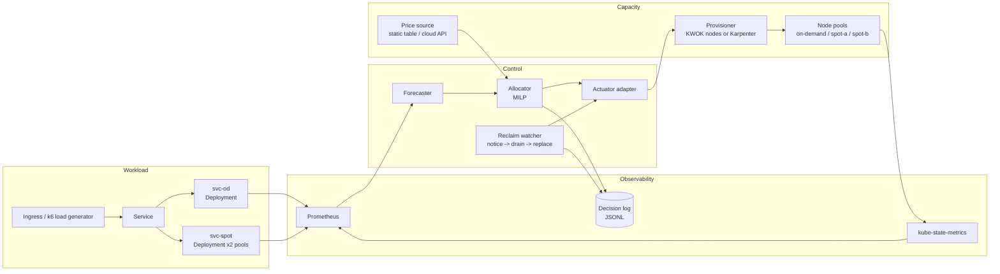
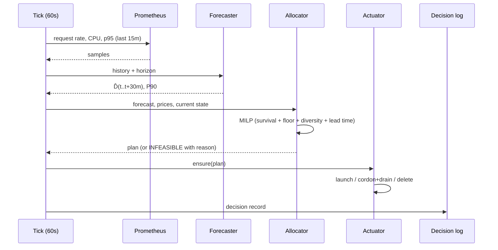
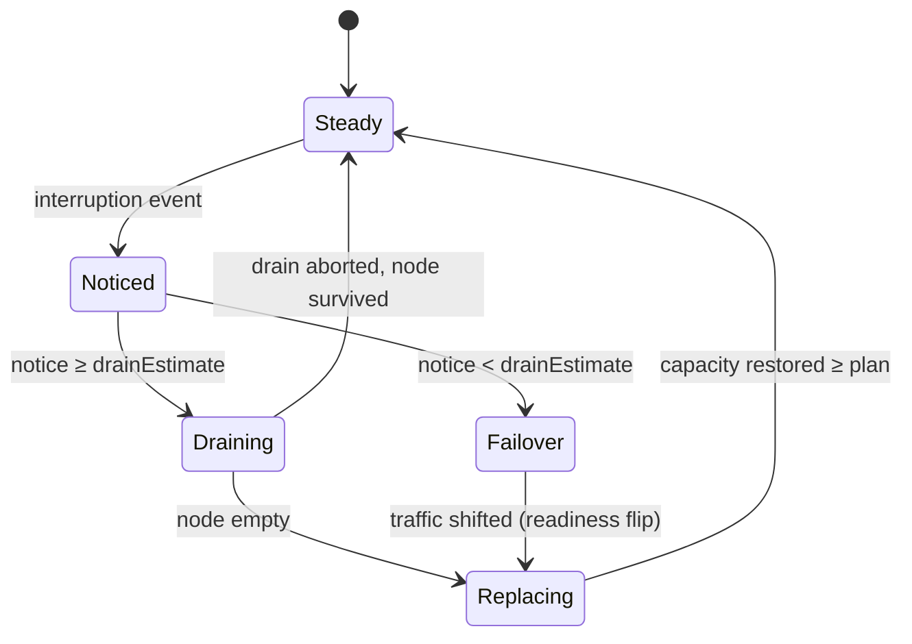

# Architecture and Algorithms

---

## 1. Goals and non-goals

**Goals**

1. A control loop that is *provably implementable* against the Kubernetes API, not a spreadsheet.
2. One policy implementation, exercised by both the simulator and the cluster (same code path, different adapters).
3. Every decision reproducible from `(seed, trace, price table, config)` and explainable from a JSON record.
4. Honest failure behaviour: infeasible constraints are reported, not hidden by relaxing silently.

**Non-goals (Assignment 2 scope)**

- Multi-cluster migration, controller canary upgrades, egress accounting — design-only, as the proposal states.
- GPU/model-serving workloads. CPU web service only.
- Beating Karpenter at node provisioning. We *use* a provisioner; we do not replace it.
- Real-time production hardening (leader election, HA, multi-tenant quotas) beyond a documented design note.

---

## 2. System context



The controller never talks to a cloud API directly. It emits a **desired capacity plan**; an adapter turns that into nodes. This is what makes the same policy runnable in SimPy, in KWOK, and (optionally) on AWS.

---

## 3. Testbed tiers

| Tier | Runs | What it validates | What it cannot validate | Runtime |
|---|---|---|---|---|
| **T0** Data layer | Always | Trace realism, price anchoring, seed reproducibility | Anything dynamic | seconds |
| **T1** SimPy simulator | CI + experiments | Policy comparison, sensitivity, statistics, cost/SLO model | Real scheduler/eviction behaviour | 30-day run ≈ 1–3 s |
| **T2** kind + KWOK | Nightly + demo | Real API objects, scheduler, HPA, eviction, PDB, node lifecycle, audit log | Real latency, real network, real kubelet | 1–4 h runs |
| **T3** kind + real pods | Weekly + demo | Real p95, real drain, lost in-flight requests, OpenCost cross-check | Scale (≤ 6 nodes), 30-day horizons | 10–30 min runs |
| **T4** AWS (optional) | Once, if budget approved | Real interruption notice path (EventBridge/SQS), real spot launch | Statistical significance | 2 × 2 h |

**Rule:** headline cost/savings numbers come from **T1**; every claim that a human could reasonably doubt ("does it actually drain without losing requests?") is backed by **T3** (or **T4**); **T2** exists to prove the policy is not simulator-only.

---

## 4. Components

| Component | Responsibility | Key interfaces | Failure behaviour |
|---|---|---|---|
| **Forecaster** | Produce `D̂(t+τ)` for τ ∈ [0, 30 min] with a P90 quantile | `forecast(history, horizon) -> Forecast` | Falls back to `current_demand × (1+h)`; marks record `forecast_degraded=true` |
| **Price source** | `price(instance_type, pool, t) -> $/h` | `PriceTable` protocol | Uses last known price; if stale > 15 min, freezes spot purchases and logs `STALE_PRICE` |
| **Allocator** | Solve the MILP; return node counts per `(type, pool)` | `allocate(D̂, prices, state, config) -> Plan` | On infeasible: relax `h` stepwise, then force all on-demand; never returns an unsafe plan silently |
| **Actuator adapter** | Reconcile actual nodes to `Plan` | `ensure(plan)`, `drain(node, deadline)` | Retries with backoff; never deletes a node it did not create |
| **Reclaim watcher** | Consume interruption notices, drive the drain/replace state machine | `on_notice(node, deadline)` | If notice is missing, treats node disappearance as an abrupt loss and records it |
| **Decision logger** | Append one JSON record per tick and per event | `log(record)` | Buffered write, fsync per tick; record loss is itself an alertable metric |
| **Cost ledger** | Accumulate node-seconds × price | `accrue(nodes, dt)` | Monotonic; recomputed from node events at the end of a run to check drift |
| **SLO evaluator** | Per-bucket p95 + success rate + violation minutes | `evaluate(bucket) -> SloSample` | Uses the analytic model in T1/T2 and measured histograms in T3 |

---

## 5. Data contracts

### 5.1 Custom resource

```yaml
apiVersion: spothedge.io/v1alpha1
kind: HedgedService
metadata:
  name: checkout-api
spec:
  target:
    deploymentOd: svc-od
    deploymentSpot: svc-spot
    service: checkout-api
  slo:
    p95LatencyMs: 150          # fixed before testing; see README decision 2
    minAvailability: 0.999
    measurementWindow: 60s
  capacity:
    podCpuRequest: 500m
    maxPodsPerNode: 16
  policy:
    tickSeconds: 60
    horizonSeconds: 1800
    headroomH: 0.15
    lossFractionQ: 0.333       # assumed simultaneous spot loss
    onDemandFloorVcpu: 8
    diversityBeta: 0.65
    drainHeadroomNodeVcpu: 8   # largest node we are willing to lose
    leadTimeSeconds: 90
    maxSpotPools: 2
    churnPenaltyPerNode: 0.02  # $/node change, hysteresis
  constraints:
    allowSpot: true
    maxNodes: 40
    maxSpotShare: 0.85
status:
  currentPlan: {...}
  lastDecisionId: "2026-12-01T10:03:00Z-7f3a"
  conditions:
    - type: Feasible
      status: "True"
    - type: ForecastDegraded
      status: "False"
```

### 5.2 Decision record (one line of JSONL)

This is the artifact the proposal's objective 4 asks for. It must be sufficient to **replay** the decision.

```json
{
  "schemaVersion": "1.0",
  "decisionId": "2026-12-01T10:03:00Z-7f3a",
  "experimentId": "primary/hedge/d65/indep/seed07",
  "tick": 1003,
  "inputs": {
    "demandForecastVcpu": 71.4,
    "demandP90Vcpu": 78.2,
    "forecastHorizonS": 1800,
    "forecastLeadTimeS": 90,
    "headroomH": 0.15,
    "drainHeadroomVcpu": 8.0,
    "lossFractionQ": 0.333,
    "prices": {
      "od/c6i.2xlarge": 0.34,
      "spot-a/c6i.2xlarge": 0.119,
      "spot-b/m6i.2xlarge": 0.106
    },
    "noticeWindowS": 120,
    "current": {"odVcpu": 32, "spotVcpu": 48, "nodes": 10}
  },
  "constraints": {
    "survivalLhs": 40.0,
    "survivalRhs": 97.9,
    "survivalSlack": 57.9,
    "drainSlackVcpu": 8.0,
    "diversityMaxPoolShare": 0.54,
    "status": "SATISFIED"
  },
  "plan": {
    "nodes": [
      {"pool": "on-demand", "type": "c6i.2xlarge", "count": 5},
      {"pool": "spot-a", "type": "c6i.2xlarge", "count": 4},
      {"pool": "spot-b", "type": "m6i.2xlarge", "count": 4}
    ],
    "predictedCostPerHour": 2.61,
    "predictedP95Ms": 118,
    "predictedAvailability": 0.9994
  },
  "reason": "COST_MIN_SUBJECT_TO_SURVIVAL",
  "solver": {"name": "CBC", "status": "OPTIMAL", "runtimeMs": 41},
  "action": {"launched": ["spot-b/m6i.2xlarge"], "removed": [], "drained": []}
}
```

---

## 6. Control loop



**Timing budget per tick:** 15 s scrape + 2 s forecast + ≤ 200 ms solve + remainder for actuation. The solve must be bounded (`timeLimit=2s`) so a pathological MILP cannot stall the loop.

---

## 7. Algorithms

### 7.1 Forecast

Seasonal-naive with EWMA residual correction, because it is explainable and hard to overfit:

```
base(t+τ)      = D(t + τ − 24h)                       # same time yesterday
level(t)       = EWMA(D, α=0.2)
residual(t)    = D(t) − base(t)
corr(t)        = EWMA(residual, α=0.1)
D̂(t+τ)         = max(0, base(t+τ) + corr(t))
D̂_90(t+τ)      = D̂(t+τ) + z_0.9 · σ_residual(7d)
```

Report MAPE and P90 coverage (fraction of actuals ≤ predicted P90, target ≈ 0.90). If coverage is outside 0.85–0.95, the sizing quantile is wrong and every downstream cost number is suspect — this is a **gate**, not a footnote.

### 7.2 Allocation (MILP)

Sets: instance types `i ∈ I` (2/4/8/16 vCPU), pools `p ∈ {od, spot-a, spot-b}`.
Variables: `x[i,p] ∈ ℤ≥0` node counts.
Derived: `C_p = Σ_i cap_i · x[i,p]`, `C_od = C_od_pool`, `C_spot = C_spot-a + C_spot-b`.

```
minimise   Σ_{i,p} price[i,p] · x[i,p]
         + churnPenalty · Σ_{i,p} |x[i,p] − x_prev[i,p]|      (linearised with two non-negative vars)

subject to
  (survival)   C_od + (1 − q) · C_spot  ≥  D_eff
  (demand)     C_od + C_spot            ≥  D_eff
  (floor)      C_od                     ≥  max(floorVcpu, largestNodeVcpu)
  (diversity)  C_spot-a ≤ β · C_spot ;  C_spot-b ≤ β · C_spot
  (spot cap)   C_spot                   ≤  maxSpotShare · (C_od + C_spot)
  (quota)      Σ_p x[i,p]               ≤  quota[i]
where
  D_eff = D̂_90(t + leadTime) · (1 + h) + drainHeadroomVcpu
```

Notes that matter for correctness:

- With `q = 1`, the survival constraint degenerates to `C_od ≥ D_eff` — spot buys nothing. That is the correct behaviour and a unit test.
- At peak demand, `D_eff` includes the full `drainHeadroomVcpu`, so the plan does not pack the cluster to the last core.
- `leadTime` shifts the demand target forward; without it, the morning ramp always arrives late. Test: ramp from 40 → 160 vCPU over 30 min with `leadTime = 90 s`; the plan must be provisioned *before* demand, not after.
- Discrete capacities mean the LP often has slack; `survivalSlack` is logged so the report can show *how much* safety margin was bought and at what price.

**Infeasibility ladder** (never silent):

1. Relax `h` in steps of 5 pp, down to 0 → log `RELAXED_HEADROOM`.
2. Force `q = 1` (all on-demand), raise `maxNodes` → log `SPOT_DISABLED`.
3. If still infeasible, keep current capacity, emit `INFEASIBLE` condition, alert, and **do not** pretend the SLO is met.

### 7.3 Reclaim state machine



Deadline logic:

```
drainEstimate = podTerminationGracePeriod + readinessPropagation + safety(5s)
if noticeWindow >= drainEstimate:
    taint node (NoSchedule)  -> flip readiness -> evict respecting PDB -> wait -> delete
else:
    flip readiness of pods on node first (stop new traffic)
    -> immediately provision replacement capacity at higher priority
    -> accept and count in-flight loss
```

`drainEstimate` is measured in T3 and configurable; the 30 s Azure case is exactly where it matters.

---

## 8. Cost and SLO models

### 8.1 Cost (authoritative)

```
cost(window) = Σ_t Σ_{n ∈ nodes(t)} price[node.type, node.pool] · Δt / 3600
```

with `Δt` from node `Ready` to node deletion (billed from launch in the cloud, but we model launch→delete and state the convention). Idle capacity is included — that is the point of a cost comparison.

### 8.2 Latency

Per replica: `S ~ LogNormal(μ=40 ms, σ such that cv=1.2)`; concurrency `c` = max concurrent requests per pod.
Bucket-level `ρ = λ·E[S] / c`. For `ρ < 1`:

```
Wq_M/M/c  from Erlang-C
Wq_M/G/c ≈ Wq_M/M/c · (Ca² + Cs²)/2          (Allen–Cunneen)
p95       ≈ E[S] + Wq · factor(c, ρ)          (fit against T3)
```

For `ρ ≥ 1`, requests queue; a configurable queue bound converts overflow into failures. This is what produces both "SLO violation minutes" and "failed requests" without simulating 260 M individual requests.

**Calibration gate:** run T3 for 20 min at 3 load levels; the model's p95 must be within 15% at the target load, otherwise fit an empirical `latency(rps)` curve and use that in T1.

### 8.3 Availability and lost requests

```
availability      = 1 − failed_requests / total_requests
violation_minutes = Σ over 1-min windows where p95 > threshold
lost_per_reclaim  ≈ λ_r · E[S] · 1{notice < drainEstimate}
```

The 43.2 min/month budget for 99.9% is the reference: the report states violation minutes against it, not a vague "high availability".

---

## 9. Deployment topology

### T2 — KWOK (control plane)

```bash
kwokctl create cluster --name spot \
  --enable-metrics-server \
  --config ./deploy/kwok/metrics-usage.yaml

kubectl apply -f deploy/kwok/nodepools.yaml        # 3 pools, labels + taints
kubectl apply -f deploy/base/service.yaml          # 2 Deployments + Service + PDB
kubectl apply -f deploy/controller/                # CRD, RBAC, Deployment
```

- Fake nodes carry `pool=on-demand|spot-a|spot-b`, `node.kubernetes.io/instance-type`, and a `spothedge.io/price-per-hour` annotation.
- Fake CPU usage is driven by a **trace replay sidecar** that patches `kwok.x-k8s.io/usage-cpu` per pod to follow the demand trace. This is how HPA sees a realistic signal.
- Reclaim injection: annotate the node with `spothedge.io/interruption-deadline`, then (for graceful cases) let the controller drain, then delete the node; for abrupt cases, delete the node immediately.

### T3 — kind (data plane)

- 1 control plane + 3 workers; `svc-od` and `svc-spot` run a small FastAPI service (`/work?ms=…` to control CPU burn, `/healthz`).
- k6 drives load; thresholds `http_req_failed<0.1%`, `p(95)<150`.
- Drain test: scale down / simulate reclaim, assert 0 failed requests (with 30–120 s notice) and record the exact count with 0 s notice.

### T4 — AWS (optional, design-complete)

- One managed node group (on-demand) + one spot node group, 2 × `c6i.2xlarge`.
- EventBridge rule → SQS → our watcher (same interface as the simulator's notice source).
- Timeboxed to 2 × 2 h; teardown checklist mandatory; budget ≤ US$50.

---

## 10. Failure modes and safety

| Failure | Expected behaviour | Test |
|---|---|---|
| Controller pod killed | **Fail-static**: no node or pod is touched; workloads keep running | `kubectl delete pod` mid-run; assert node set unchanged for 5 min |
| Prometheus unavailable | Use last value; if stale > 5 min, freeze plan and log `DEGRADED` | Block scrape; assert no scaling decisions |
| Solver timeout | Fall back to previous plan; log `SOLVER_TIMEOUT` | Inject `timeLimit=1ms` |
| Price feed stale | Stop buying spot, keep existing; log `STALE_PRICE` | Freeze price file |
| Node delete fails | Retry with backoff; never orphan a node silently | Fake API error in unit test |
| Two controllers running | Leader election (or a lease) — design note; single replica in prototype | Document only |
| Quota exhausted at launch | Mark pool unavailable for N minutes; re-plan with remaining pools | Fault injection in T2 |

**RBAC:** the controller gets `nodes` (create/delete/patch), `pods` (list/delete via eviction), `nodeclaims` (optional), and read-only on metrics; nothing else. A `ClusterRole` manifest is part of the deliverable, and the report shows it.

---

## 11. Repository layout

```
spot-hedged-orchestrator/
├── src/spothedge/
│   ├── model/            # dataclasses: Forecast, Plan, NodeSpec, DecisionRecord
│   ├── forecast/         # seasonal naive + EWMA + quantiles
│   ├── policy/           # MILP, infeasibility ladder, hysteresis
│   ├── simulate/         # SimPy engine, node lifecycle, cost ledger, queueing model
│   ├── actuator/         # base protocol, kwok_node.py, karpenter.py, sim.py
│   ├── controller/       # kopf handlers, Prometheus client, decision log
│   └── cli.py            # `spothedge sim|controller|report`
├── deploy/
│   ├── kwok/             # nodepools, metrics-usage, trace replayer
│   ├── base/             # app, service, PDB, HPA (baseline)
│   ├── controller/       # CRD, RBAC, deployment
│   └── kind/             # cluster config, k6 scripts
├── experiments/
│   ├── configs/          # YAML per experiment cell
│   ├── traces/           # generated demand CSVs (gitignored if large)
│   └── runs/             # results (parquet/csv), figure inputs
├── scripts/              # fetch_prices.py, make_trace.py, inject_reclaim.sh
├── tests/                # unit + property tests for policy and state machine
├── docs/                 # these documents + runbook
└── report/               # LaTeX/Markdown report and figures
```

---

## 12. Interfaces (Python)

```python
class PriceSource(Protocol):
    def price(self, instance_type: str, pool: Pool, t: datetime) -> float: ...

class Actuator(Protocol):
    def ensure(self, plan: Plan) -> None: ...
    def drain(self, node: str, deadline_s: int) -> None: ...
    def current(self) -> ClusterState: ...

class NoticeSource(Protocol):
    def poll(self) -> list[Interruption]: ...   # (node, deadline, source)

class SloModel(Protocol):
    def p95(self, replicas: int, rps: float, service_time: float) -> float: ...
```

The simulator implements `Actuator` with an in-memory node list; KWOK implements it with `Node` objects; Karpenter implements it with `NodeClaim`s; AWS (optional) implements it with EC2 APIs. **The policy code does not change between tiers** — this is the central architectural claim of the project, and the report should demonstrate it (same file, same tests, four adapters).
