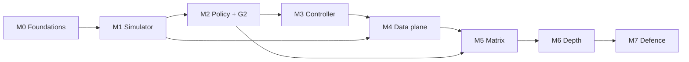

# Milestones, Scope Ladder and Ownership

There is **no fixed deadline**. The constraint is therefore effort, quality and diminishing returns — not calendar. This document replaces the earlier week-by-week schedule with:

1. **Milestones** that are ordered by dependency, each with an exit gate.
2. A **scope ladder** that says what "as much as we can" actually means, in hours and in value.
3. The ownership, risk and cadence rules that keep four people moving in the same direction.

Dates are deliberately absent. When a milestone starts, put its target date on the board; do not let a date move a gate.

---

## 1. Operating assumptions

- **Capacity:** 4 people × ~12–14 h/week. A milestone slips only when the gate is genuinely blocked, not when a self-imposed date passes.
- **Total planned effort for the course-grade artifact:** ~435 h of work + ~60 h buffer ≈ **495 h**. At 14 h/person/week that is ~9 weeks of elapsed time; at 12 h it is ~10.5. There is no penalty for taking longer, so protect quality over speed.
- **Quality bar:** every claim in the report traces to a reproducible artifact; every gate is passed before the next milestone starts.
- **Hardware:** Docker Desktop/WSL2, ≥16 GB RAM, 4 cores per member; one designated "experiment runner".

---

## 2. Milestones

| ID | Milestone | Contains | Effort | Exit gate |
|---|---|---|---|---|
| **M0** | Foundations | Repo, CI, environment, frozen definitions, trace, prices | 25 h | **G0** — p95 fixed; `make sim-smoke` green; kind+KWOK works on ≥3 laptops |
| **M1** | Data + simulator | Trace pipeline, node lifecycle, cost ledger, queueing SLO, interruption generators | 100 h | **G1** — P0 cost = $4,672 ±1%; 30-day run < 3 s; same seed ⇒ identical output |
| **M2** | Policy and first comparison | Forecast, MILP, edge cases, P0–P4 baselines, 20-seed runner | 60 h | **G2** — P3 ≥20% cheaper than P1 at 65% discount with ≤0.1 pp availability loss |
| **M3** | Controller and cluster | CRD, kopf loop, decision log, KWOK actuator, reclaim injection, dashboards | 105 h | **G3** — 2 h KWOK run, 3 reclaims, 100% audit records, fail-static proven |
| **M4** | Data plane and lifecycle | kind + k6, real p95, drain tests, OpenCost cross-check, teardown/spend report | 30 h | **G4** — p95 ≤ threshold; **0 failed requests** at 30 s notice; teardown clean |
| **M5** | Experiment matrix | 2,800 simulator runs, ablation, failure classification, figures | 55 h | **G5** — every figure regenerated by one command; every failure classified |
| **M6** | Depth and optional live run | Sensitivity, cross-tier consistency, optional AWS validation, report draft | 60 h | **G6** — draft complete; live run archived or explicitly marked not attempted |
| **M7** | Freeze and defence | Final report, demo, viva bank, archive | 60 h | **G7** — submitted; clean-clone reproducibility; each member can defend any subsystem |

**Buffer:** 60 h, unallocated. It is consumed by M3 (the riskiest milestone) or by report overruns — never by new features.

### Critical path

M2 is the **go/no-go**. Building M3 on a policy that has not beaten the baseline is the single most expensive mistake available; if G2 fails, spend the next block on the model, not on Kubernetes.

---

## 3. Scope ladder (how far to go)

Each tier is cumulative and independently defensible. Pick the highest tier you can finish *well*; do not start a tier you cannot close, because a half-built controller is worth less than a complete simulator study.

| Tier | Name | Adds | Cumulative effort | What the report can claim | Recommended? |
|---|---|---|---|---|---|
| **1** | Defensible | M0–M2 + report core | ~230 h | A trace-driven comparison of four policies against a fixed p95 and availability target, with pre-registered hypotheses and reproducible artifacts | Minimum acceptable |
| **2** | Complete artifact | + M3, M4 | ~375 h | The same policy runs unmodified against the real Kubernetes API, drains safely, and loses zero in-flight requests at a 30 s notice | Strong course project |
| **3** | **Recommended ceiling** | + M5, M6, M7, optional live run | ~495 h | Full statistical comparison, sensitivity, failure analysis, demo, viva, and (optionally) one credential-grade cloud validation | **Target this** |
| **4** | Research-grade | Stretch menu below | 700 h+ | A short paper: multi-provider hedging, lookahead control, adversarial market tests | Only after Tier 3 is closed and archived |

**Stopping rule.** Stop climbing when all of the following hold: (a) every gate through G7 is passed; (b) two consecutive working blocks add no new primary result, only polish; (c) a clean clone reproduces the report in one command. Adding features after that point reduces quality through churn.

---

## 4. Stretch menu (Tier 4)

Ordered by value per hour, with the honest cost.

| # | Extension | Hours | Why it is worth it | Risk |
|---|---|---|---|---|
| S1 | **Multi-AZ / multi-region spot pools** (SkyServe-style placement) | 40 | Directly attacks correlated loss, which is the weakest part of the current model | Needs a placement/failure-domain abstraction; medium refactor |
| S2 | **MPC with 2–4 h lookahead** | 35 | Converts a myopic per-tick rule into a controller with a plan; likely the strongest single improvement to cost | More state, harder to explain; keep the myopic rule as an ablation |
| S3 | **Randomised hedge policy** (ROSS-inspired) | 30 | Tests the theoretical claim that deterministic thresholds lose under adversarial markets; a genuinely novel comparison for this course | Requires an adversarial market generator; results may be negative (that is still a result) |
| S4 | **Spot price forecasting + backtest** | 30 | Justifies using price history instead of a static discount | Needs real price data; without credentials this is synthetic-only, which weakens it |
| S5 | **Capacity-error / insufficient-capacity modelling** | 20 | Closes the biggest realism gap in the simulator (launches that simply fail) | Small model change; must be reported as a sensitivity, not a headline |
| S6 | **Real Karpenter on a live cluster** | 40 + $ | Removes the "KWOK only" objection | Cost and teardown discipline; needs the AWS budget |
| S7 | **Chaos suite** (controller kill, API latency, stale metrics, solver timeout) | 25 | Makes the fail-static claims empirical rather than aspirational | Mostly test-writing; low intellectual risk |
| S8 | **Decision-log replay dashboard** | 25 | Makes the auditability objective visible in the demo | UI work with little scientific value |
| S9 | **90-day trace with seasonal events** | 20 | Tests whether 30 days hides a seasonal failure | Longer runs; trace construction effort |
| S10 | **Paper draft** (8 pages, workshop style) | 40 | Consolidates the work; useful if anyone wants a publication | Writing time displaces experiments |

Do S7 and S5 first if the goal is credibility; S1 and S2 if the goal is a stronger result; S10 only after everything else is archived.

---

## 5. Ownership (RACI)

| Area | Lead (R) | Accountable (A) | Consulted (C) | Informed (I) |
|---|---|---|---|---|
| Policy / optimiser / forecast | Amina | Amina | Mahnoor | All |
| Simulator engine / data layer | Mahnoor | Mahnoor | Amina | All |
| Cluster / actuator / injection | Bilal | Bilal | Rabia | All |
| Controller integration | Amina | Amina | Bilal | All |
| Evaluation / observability | Mahnoor | Mahnoor | Amina | All |
| Lifecycle / runbook / report | Rabia | Rabia | All | All |
| Demo / viva | Rabia | All | — | — |

Every PR needs a reviewer who is not the author, and the reviewer must be able to explain the change. Rotate the demo presenter so nobody is a stranger to any subsystem — the viva requires all four to understand the whole system.

---

## 6. Effort budget

| Epic | Hours | Notes |
|---|---|---|
| E1 Foundations, repo, CI | 25 | Reading + environment setup |
| E2 Data layer (trace, prices, generators) | 35 | Trace availability is the main external unknown |
| E3 Simulator engine | 65 | Node lifecycle, ledger, queueing model |
| E4 Policy + forecast | 60 | MILP, edge cases, infeasibility ladder |
| E5 Controller (kopf, CRD, logs) | 55 | Prometheus client, replay, tests |
| E6 Cluster / actuator / injection | 50 | KWOK, kind, k6, reclaim scripts |
| E7 Data-plane validation + calibration | 30 | Real drain, p95, OpenCost |
| E8 Experiments + analysis + figures | 55 | 2,800 runs + failure analysis |
| E9 Report + demo + viva | 60 | Figures, rehearsal, Q&A bank |
| **Buffer** | **60** | Not planned into any milestone |
| **Total** | **495 h** | Excludes Tier 4 stretch |

If a milestone overruns by more than 20%, descend the ladder (§7) rather than silently extending it.

---

## 7. Scope discipline

**If a milestone stalls** — descend in this order, and record the descent in the report:

1. Optional live AWS run → becomes a design section with the EventBridge/SQS path documented.
2. Karpenter adapter → keep the protocol, document the production wiring.
3. Volatile-price slice and half the sensitivity grid.
4. Seeds 20 → 10 (wider CIs, still paired).
5. T2 run 4 h → 1 h.
6. T3 to two configurations (100 rps at 30 s and 0 s notice).

**Never descend past:** the T1 policy comparison, the decision log, the T3 drain test, the teardown/runbook, or the failure table. Those *are* the project.

**If a milestone finishes early** — climb the stretch menu, but only in the order S7 → S5 → S1 → S2.

---

## 8. Risk register

| # | Risk | L | I | Trigger | Mitigation | Owner |
|---|---|---|---|---|---|---|
| R1 | KWOK↔Karpenter integration burns time | M | H | No NodeClaim after 2 days | `Actuator` abstraction; `kwok-node` is the default; Karpenter is documented, not required | Bilal |
| R2 | Fake metrics don't drive HPA | M | M | `kubectl top` empty / HPA `<unknown>` | KWOK `metrics-usage.yaml` + `kwok.x-k8s.io/usage-cpu`; fallback Prometheus adapter | Bilal |
| R3 | OpenCost reports $0 / on-demand in KWOK | H | M | Allocation API returns zero or list price | Cost ledger is authoritative; OpenCost only in T3; disclose the default-pricing caveat | Mahnoor |
| R4 | Simulator too slow for the matrix | L | M | 30-day run > 10 s | 1-min buckets, vectorised ledger, multiprocessing; cut seeds before model fidelity | Mahnoor |
| R5 | Laptop RAM/CPU limits | M | M | kind OOM, 100% CPU | 3 workers max; pin CPU; one designated runner; CI for the matrix | Bilal |
| R6 | Scope creep ("no deadline" = "add everything") | **H** | **H** | A new idea lands mid-milestone | Scope ladder + stopping rule; new ideas go to the stretch menu, not the current milestone | Rabia |
| R7 | Skill gaps (kopf, asyncio, MILP) | M | M | Stuck > 2 h | Pairing; a one-day spike before M3; greedy fallback behind the same interface | Amina |
| R8 | Results and report diverge | M | H | Numbers typed by hand | Report tables generated from `summary.json`; `make verify` before every submission | Rabia |
| R9 | Trace dataset unavailable | L | M | Download fails | Documented synthetic fallback (protocol §3); never silent substitution | Mahnoor |
| R10 | Live AWS cost overrun | L | M | > US$30 after the first run | Hard budget tag, 2 h cap, same-day teardown, alarm at 80% | Bilal |
| R11 | "Zero lost requests" not achieved at 30 s | M | M | T3 measurement | Report measured loss and mechanism; the proposal already conditions the goal on adequate floor + draining | Amina |
| R12 | Loss of momentum without a deadline | **H** | **H** | Two weeks with no merged PR | Weekly gate demo; milestones on the board; the stopping rule defines "done" | All |

R6 and R12 are the two risks created by removing the deadline. They are managed by the scope ladder and the weekly cadence, not by optimism.

---

## 9. Cadence

| When | What | Output |
|---|---|---|
| Start of milestone | Confirm scope against the exit gate | Board updated, target date set |
| Weekly, 45 min | Demo on the shared screen + merge review | Gate status recorded |
| Weekly, 15 min | Risk register update | Living doc |
| End of milestone | Gate review against explicit criteria | Pass / descend / rework |

**Definition of done (every ticket):** code merged to `main`; one test that would fail if the feature were removed; a runbook line if it is operational; a number in the report if it is experimental.
